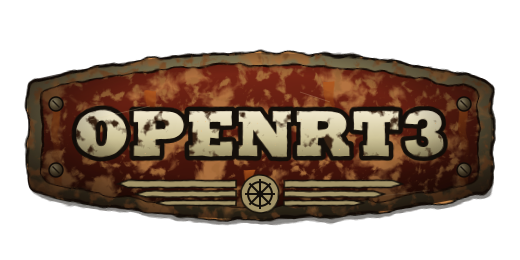

<div align="center">



# OpenRT3

**A decompilation of Railroad Tycoon 3, rebuilt function by function in C++. It runs on your original game data.**


*Plays like the original, write for write and frame for frame.*

</div>

---

## 🚂 About

OpenRT3 is a decompilation project and reimplementation of `RT3.exe` from Railroad Tycoon 3
(version 1.06, built 2004-09-08), decompiled with Ghidra. This is a *functional* decomp: the
rewrite behaves exactly like the original, but it is not compiled to byte-identical machine
code (see the roadmap). It is built the way [OpenRCT2](https://github.com/OpenRCT2/OpenRCT2) and [re3](https://github.com/GTAmodding/re3)
were built: the rewrite is loaded into the running game and replaces the game's code one
function at a time, so the game stays playable the whole way through.

- 🧮 **Same results as the original.** The game state, the frames drawn and the multiplayer sync
  all match the original game.
- 🗂 **Grouped like the original source.** 69 files, one per original object file, split along
  the address ranges the compiler kept together.
- 🌐 **Multiplayer included.** LAN play between the original and the rewrite stays in sync.
- 🧰 **Original developer menu.** The game's hidden `MNUDFLT` debug menu can be switched back on
  ([docs/developer_menu.md](docs/developer_menu.md)).

> [!IMPORTANT]
> You need your own copy of Railroad Tycoon 3. This repository contains no game data,
> no game binaries and no raw decompiler output (the Ghidra decompile is generated locally from
> your own exe, see *Layout*).

## 📊 Progress

| Area | Status | Details |
|---|---|---|
| Game code (below `0x517c00`) | ✅ | rewritten, one file per original object file |
| Engine code (`Misc.cpp`, `Render.cpp`, …) | ✅ | rewritten |
| All game functions | ✅ | 4,390 of 4,390, all of the game's machine code ([docs/progress.md](docs/progress.md)) |
| Reads of never-written locals | 🟡 | where the original reads stack leftovers, the rewrite uses 0 and counts the path (`g_unwrittenReads`); exact only with byte matching |
| Differential tests | ✅ | 857 tests, plus a generic test of 1,203 leaf functions |
| Save-game, scenario and map-editor runs | ✅ | the same writes and the same Direct3D frames as the original |
| Two-player LAN game | ✅ | original vs. rewrite, kept in sync through companies, stations, track and a train |
| Side-by-side coverage | ✅ | every rewritten function has run next to the original ([docs/coverage.md](docs/coverage.md)) |
| Own process (`OpenRT3.exe`) | ✅ | loads the game image itself and runs our code in it |
| Numeric constants and tables in our own code | 🟡 | read from our own copy of the game's read-only data, made from your RT3.exe at build time; strings and vtables still from the game image ([docs/imagedeps.md](docs/imagedeps.md)) |
| Game globals in our own code | ⏳ | still at their original addresses in the game image |
| D3DX 8, GameSpy SDK, C runtime, libjpeg | ⏳ | still run from the game image |
| Online play through a revived lobby | 🔍 | should work, not tested yet |

✅ done · 🟡 partial · 🔍 untested · ⏳ planned

## 🧭 Roadmap

```
Phase 1  Replace every game function in the running game ........ ✅
Phase 2  Prove it: difftests, simcheck, mpcheck, coverage ........ ✅
Phase 3  Run in our own process (OpenRT3.exe) .................... ✅
Phase 4  Move the game's global data into our own code ........... 🟡  ← we are here
Phase 5  Replace the linked-in libraries (CRT, D3DX, GameSpy) .... ⏳
Phase 6  Free of the original exe: only the game data is needed .. ⏳
Phase 7  Modernized version (see below) .......................... ⏳
Later    Matching decomp: byte-identical build with MSVC 7.0 ........ 💭
```

**Modernized version.** Once the game no longer depends on the original exe, a second build
can improve on it while the faithful build stays exactly like the original: modern resolutions
and widescreen, a current graphics API instead of Direct3D 8, a 64-bit build, bug fixes and
quality-of-life changes, and easier modding.

💭 = idea, not planned yet. The original exe was built with MSVC 7.0 (build 9466), so a
byte-matching build would be possible later on top of the functional one.

## 🔧 Building

You need:

- Visual Studio 2019 C++ build tools (x86)
- Python 3, for the tools
- `RT3.exe` version **1.06 without copy protection**, in a game folder next to this repo
  (`..\Railroad Tycoon 3 Full Game\`). The copy-protected exe from the original CD cannot be
  used. The tools check the exe's headers and tell you if they find no suitable one.

The first time you build, generate `src/game/builtin_strings.inc` (text taken from the original
exe, so it is not committed): run the `dump_tables` difftest, then
`python tools/gen_builtin_strings.py`.

```bat
build.bat          :: builds rt3re.dll, rt3re_test.dll, rt3re.exe, OpenRT3.exe into the game folder
build.bat test     :: also runs the differential tests
```

## 🎮 Running

From the game folder:

| Command | What it does |
|---|---|
| `OpenRT3.exe` | runs the game in its own process: maps the image from `RT3.exe` to its original address, connects the imports, loads `rt3re.dll`. Game arguments (`-s2`, …) are passed on. |
| `rt3re.exe` | starts `RT3.exe` and loads `rt3re.dll` into it |
| `rt3re.exe --dev-menu` | the same, with the original developer menu ([docs/developer_menu.md](docs/developer_menu.md)) |

Any rewritten function can be switched back to the original in `rt3re.ini`
(`[replace] Name=0`).

**Multiplayer.** GameSpy's servers are gone.
[RT3Multiplayer](https://github.com/FlorianFFF/RT3Multiplayer/releases) provides a
replacement lobby server and sets the game up to use it. The GameSpy code still runs from the
game image unchanged, so this should also work with OpenRT3, but it has not been tested in an
online game yet.

## 🔬 Methodology

1. **Replace, don't restart.** Each rewrite is tagged `RT3_REPLACE(0xADDRESS, Function)`. At
   startup the DLL writes a `JMP` over the original, so the game calls our code instead.
   Anything not yet rewritten keeps running as original code.
2. **The exe is the reference.** A function counts as done only when it passes a differential
   test against the original, or, for code that only makes sense in a running game (rendering,
   UI, networking), when a recorded in-game check passes.
3. **Compare everything.** Return values, memory, writes to globals, every byte of a save, the
   CRC of every frame and the multiplayer state check all have to match. Even float-to-int
   conversion goes through the exe's own `_ftol`.
4. **Keep the boundaries clean.** The C runtime, libjpeg and the imports are each reached through
   one header (`crt.h`, `jpeglib.h`, `imports.h`), so swapping one out later means changing one
   file. Globals get names from one table (`tools/globals.tsv` → `src/core/globals.h`).

A small differential test:

```cpp
DIFFTEST(text_ToUpper) {
    auto orig = (int(__fastcall*)(char))0x51d660;
    for (int c = 0; c < 256; ++c)
        EXPECT_EQ(orig((char)c), rt3::ToUpper((char)c), "c=%d", c);
}
```

`__thiscall` methods are written as `__fastcall(this, int /*edx*/, ...)`, which gives the same
register layout. The full test setup is described in **[docs/testing.md](docs/testing.md)**:
difftests, the generic leaf test, `simcheck.py` (saves, scenarios, the editor, scripted calls,
drawing), `mpcheck.py` (host and client), coverage, `callcheck.py`, and the mod-free test mirror.

## 🗂 Layout

```
src/game/       rewritten game code (below 0x517c00), one file per original object file
src/engine/     rewritten engine (0x517c00 on: Misc.cpp, MouseCursor.cpp, Render.cpp, …)
src/core/       logging, shared engine types, CRT / libjpeg / import bridges, globals.h
src/hook/       replacement registry and JMP patching
src/assets/     file-format readers (PK4, …)
src/launcher/   rt3re.exe and OpenRT3.exe
tests/          differential tests
tools/          progress, simcheck, mpcheck, coverage, test mirror, format tools, vc.bat
decomp/         full Ghidra decompile, one .c per function (regenerable, not committed)
docs/           progress, coverage, testing, fun findings
```

Only `Misc.cpp` and `MouseCursor.cpp` are known original file names, because the exe still
contains those two paths. The other names are reconstructions.

The decompile in `decomp/` is the starting point for every rewrite: one Ghidra pseudo-C file
per original function, plus a call graph. It is generated from your own exe and is never
committed. To regenerate it (Ghidra 11.3.2 headless, about 10 minutes):

```
analyzeHeadless <tmp-proj-dir> RT3H -import RT3.exe -scriptPath reversing_notes/tools ^
    -postScript DecompAll.java rebuild/decomp
```

`python tools/progress.py` writes [docs/progress.md](docs/progress.md).

## 🙏 Inspiration

- [OpenRCT2](https://github.com/OpenRCT2/OpenRCT2), [re3](https://github.com/GTAmodding/re3) and
  [OpenTTD](https://github.com/OpenTTD/OpenTTD): reimplementations that run on the original
  game data.
- [RT3Multiplayer](https://github.com/FlorianFFF/RT3Multiplayer): the multiplayer revival this
  project grew out of.

## ⚖ Legal

OpenRT3 is a non-commercial fan project. It is not affiliated with or endorsed by the owners of
Railroad Tycoon 3. Railroad Tycoon is a trademark of its respective owner. The repository
contains only new code, tests and documentation. To use it you need a legitimately obtained copy
of the game.
